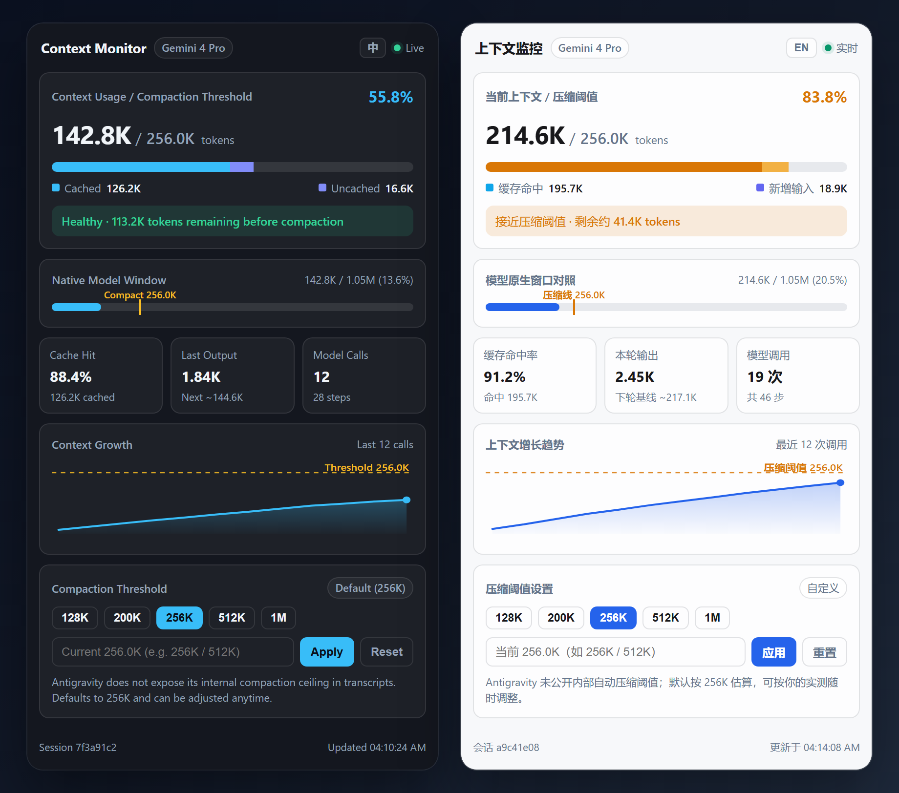

<div align="center">


# Antigravity Context Monitor

**Live context usage and compaction threshold monitor in the Antigravity side pane.**

**English** | [简体中文](README.zh-CN.md)

[](LICENSE)
[](#installation)
[](#how-it-works)
[](#features)
[](#project-structure)

<br />



</div>

---

## Features

- **Real-Time Context Usage** — Reads actual token counts (`input_tokens + cache_read_tokens`) directly from the active conversation transcript with **zero extra token overhead**.
- **Compaction Threshold & Alerts** — Displays current usage against your compaction threshold with remaining headroom and **75% (warning)** / **90% (critical)** status indicators.
- **Native Window Comparison** — Shows where the compaction threshold sits relative to the model's full context window (e.g., 256K on a 1M window).
- **Cache & Growth Insights** — Tracks Prompt Cache hit rate, last turn output, next-turn baseline estimate, and a live context growth sparkline.
- **Bilingual UI (English / 简体中文)** — Auto-detects locale and provides a one-click `EN / 中` toggle in the header, persisted across sessions.
- **Customizable Threshold & Auto-Detection** — Switch presets (`128K`–`1M`) or set any custom value; automatically detects compaction drops and offers one-click calibration.
- **Private & Local-Only** — Read-only local transcript access, loopback HTTP only, zero telemetry, and automatic light/dark theme sync.

## Installation

### Antigravity CLI

```bash
agy plugin install https://github.com/pinchuan54/antigravity-context-monitor
```

### Git Clone

**macOS / Linux:**

```bash
git clone https://github.com/pinchuan54/antigravity-context-monitor.git ~/.gemini/config/plugins/context-monitor
```

**Windows (PowerShell):**

```powershell
git clone https://github.com/pinchuan54/antigravity-context-monitor.git "$env:USERPROFILE\.gemini\config\plugins\context-monitor"
```

After installing, open the auxiliary side pane (**+**) in any Antigravity conversation and select **Context** (no restart required).

## Compaction Threshold

Antigravity does not currently expose its internal auto-compaction ceiling in `transcript.jsonl`. Threshold resolution uses the following priority:

| Priority | Source | Description |
| :--- | :--- | :--- |
| 1 | **Panel setting** | Custom threshold set from the side pane UI (saved locally) |
| 2 | **`AGY_CLI_AUTO_COMPACT_OVERRIDE`** | Environment variable override (`700000`, `800K`, `0.5M`, or `80%`) |
| 3 | **Default reference** | `256K` tokens (or `80%` of the model window if smaller) |

## How It Works

The plugin runs a lightweight Node.js sidecar (`sidecars/monitor/main.mjs`) via Antigravity's built-in `sidecar_sdk`. It performs `mtime`/`size`-cached, read-only parsing of the active conversation's `transcript.jsonl` and exposes `/api/context` over loopback (`127.0.0.1`) to the side-pane UI.

## Project Structure

```text
antigravity-context-monitor/
├── plugin.json                  # Plugin manifest
├── README.md                    # Documentation (English)
├── README.zh-CN.md              # Documentation (简体中文)
├── LICENSE                      # MIT License
├── assets/
│   ├── logo.svg                 # Plugin icon
│   └── preview.png              # Dark (EN) & Light (ZH) UI preview
└── sidecars/
    └── monitor/
        ├── package.json         # ESM manifest
        ├── sidecar.json         # Aux-pane sidecar registration
        ├── main.mjs             # Local HTTP & transcript parser
        ├── index.html           # Side pane markup
        ├── styles.css           # Theme-adaptive styles
        └── app.js               # Polling, i18n, sparkline, and controls
```

## Validation

```bash
agy plugin validate --strict .
```

## License

[MIT](LICENSE)
