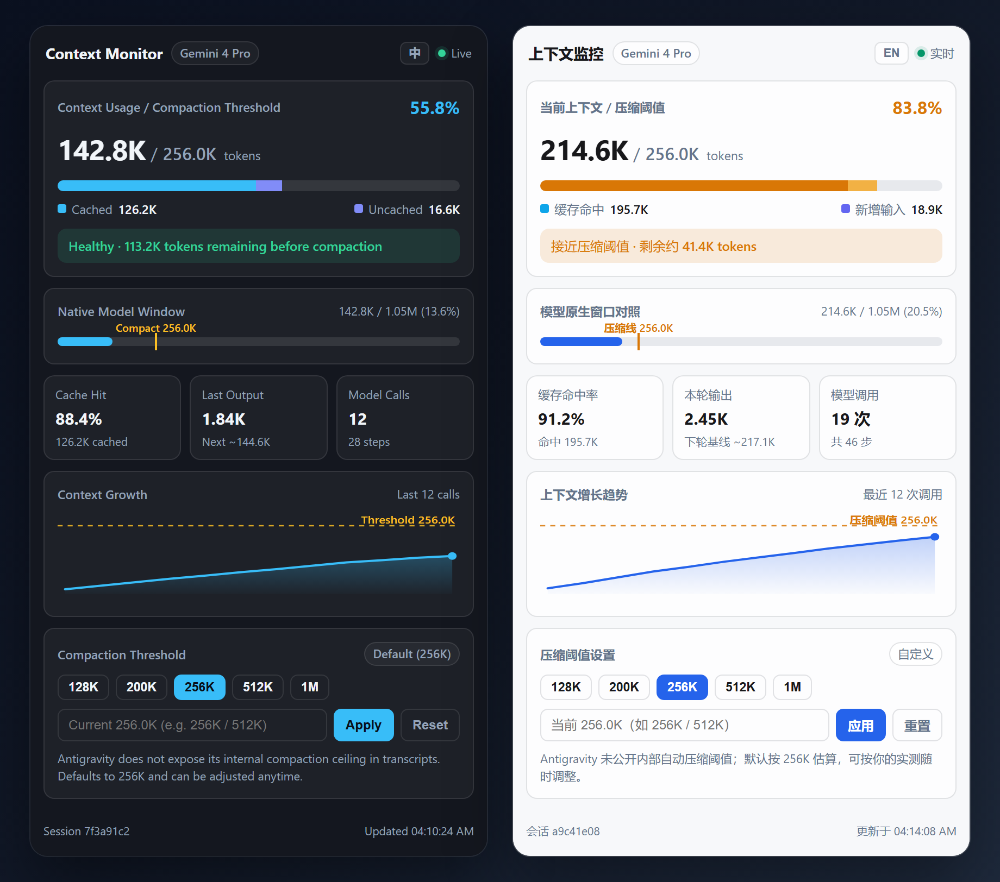

<div align="center">


# Antigravity Context Monitor

**在 Antigravity 右侧辅助面板中实时查看上下文使用量与自动压缩阈值。**

[English](README.md) | **简体中文**

[](LICENSE)
[](#安装方法)
[](#工作原理)
[](#功能特性)
[](#目录结构)

<br />



</div>

---

## 功能特性

- **实时上下文监控（零额外 Token 消耗）** — 直接只读解析当前会话的 `transcript.jsonl`，精准统计真实 `input_tokens + cache_read_tokens`。
- **压缩阈值与预警** — 直观展示 `当前上下文 / 压缩阈值` 进度条与剩余空间，超过 **75%（黄）** / **90%（红）** 自动变色提醒。
- **原生窗口对照** — 在模型总上下文窗口（如 1M）上标出压缩阈值线位置，清晰了解触发压缩的时机。
- **缓存命中率与增长趋势** — 显示 Prompt Cache 命中率、本轮输出、下轮输入基线预估以及上下文增长曲线图。
- **中英文双语切换** — 自动适配系统语言，面板右上角支持一键切换 `EN / 中` 并持久化保存偏好。
- **自定义阈值与自动压缩检测** — 提供 `128K`–`1M` 快捷预设与自定义输入；检测到会话发生压缩时自动记录峰值并支持一键校准。
- **隐私与纯本地运行** — 仅只读本地 transcript 日志，监听 `127.0.0.1` 回环地址，零外联请求，自动跟随深浅色主题。

## 安装方法

### Antigravity CLI

```bash
agy plugin install https://github.com/pinchuan54/antigravity-context-monitor
```

### Git 克隆安装

**macOS / Linux：**

```bash
git clone https://github.com/pinchuan54/antigravity-context-monitor.git ~/.gemini/config/plugins/context-monitor
```

**Windows (PowerShell)：**

```powershell
git clone https://github.com/pinchuan54/antigravity-context-monitor.git "$env:USERPROFILE\.gemini\config\plugins\context-monitor"
```

安装完成后无需重启 Antigravity，在任意对话右侧辅助面板（**+**）中选择 **Context** 即可打开。

## 压缩阈值说明

Antigravity 目前未将内部自动压缩上限直接写入 `transcript.jsonl`，插件按以下优先级确定参考阈值：

| 优先级 | 来源 | 说明 |
| :--- | :--- | :--- |
| 1 | **面板自定义设置** | 在侧边栏面板中选择的预设或自定义数值（本地持久化） |
| 2 | **`AGY_CLI_AUTO_COMPACT_OVERRIDE`** | 环境变量覆盖值（支持 `700000`、`800K`、`0.5M` 或 `80%`） |
| 3 | **默认参考值** | `256K` tokens（若模型原生窗口小于 256K，则按 80% 计算） |

## 工作原理

插件基于 Antigravity 内置 `sidecar_sdk` 运行轻量级 Node.js Sidecar（`sidecars/monitor/main.mjs`），以 `mtime`/`size` 缓存方式只读解析当前会话的 `transcript.jsonl`，并通过本地回环接口 `/api/context` 为右侧面板提供实时数据。

## 目录结构

```text
antigravity-context-monitor/
├── plugin.json                  # 插件清单
├── README.md                    # 说明文档（English）
├── README.zh-CN.md              # 说明文档（简体中文）
├── LICENSE                      # MIT 开源协议
├── assets/
│   ├── logo.svg                 # 插件图标
│   └── preview.png              # 深色（英文）/ 浅色（中文）界面预览
└── sidecars/
    └── monitor/
        ├── package.json         # ESM 配置
        ├── sidecar.json         # Aux Pane Sidecar 注册配置
        ├── main.mjs             # 本地 HTTP 与日志解析服务
        ├── index.html           # 侧边栏页面结构
        ├── styles.css           # 深浅色主题自适应样式
        └── app.js               # 轮询、中英文切换、折线图与交互
```

## 本地校验

```bash
agy plugin validate --strict .
```

## 开源协议

[MIT](LICENSE)
